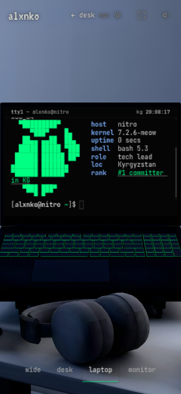
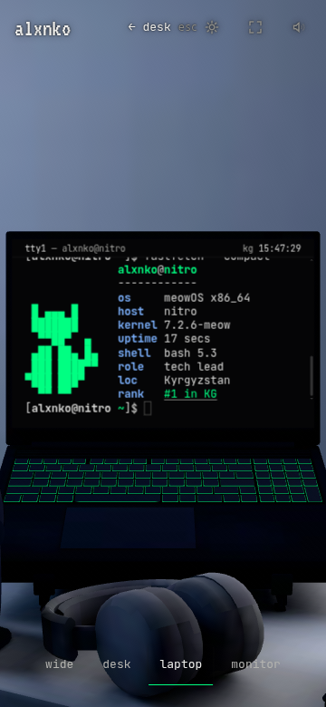

# Mobile fastfetch repair

The production phone terminal wrapped long fastfetch rows and scrolled the ears off the screen. At 360 CSS pixels the os and rank rows occupied two 30px logical lines, breaking the interleaved cat artwork. The original 12-row mark also exceeded the smallest phone screen height.

## Requirements and implementation

Use a compact 11-column, 7-row rendering of the existing pixel cat only for compact fastfetch. Bottom-align it within all ten existing fact rows. Keep the original full mark, monitor mark, contacts, colors, links and normal output wrapping. Shorten the compact rank caption and express compact long uptime in minutes. Keep the existing 24px logical font and frozen terminal grid; do not change the scene, projection, camera, assets, dependencies or budget limits.

The implementation changes only mark data and fastfetch formatting. Both compact flags retain every fact. The native browser at 360×780 shows the whole cat and single-line facts. Browser regressions cover 320, 360, 390 and 844px first/cached boots, effective font size, art visibility and ordinary long output wrapping. Existing held-handoff tests remain in the complete gate. This is emulated browser evidence, not certification on the physical phone.

## Visual evidence

## Performance

Initial JavaScript is exactly 30,720 gzip bytes against the unchanged 30,720-byte limit. No headroom remains; subsequent source changes must pass the budget again. Lazy scene JavaScript remains 172,659 bytes against 174,080. No dependencies or scene assets changed.

## Verification

The complete serial gate passed: 430 unit tests, 245 browser tests passed and 21 intentional skips; lint, build/CSP and every budget passed. The independent review and raw output are recorded in the adjacent mobile-fastfetch-evidence directory. The worker report records the reproduced failures and focused checks. No production timing claim is made from the background preview.
