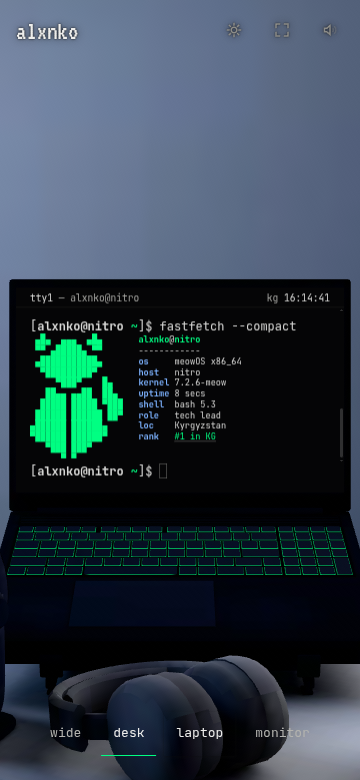

# Restore the original mobile cat

The user rejected the simplified mark and requested the original cat, allowing smaller text. This correction restores the unchanged 18×12 CAT_MARK in compact fastfetch and removes the replacement artwork.

Only mixed fastfetch art/fact rows in the 3D/loading terminal receive smaller typography. Their size derives from the frozen screen height, preserving the console-to-laptop handoff. Input, ordinary output, pure catsay artwork, lite typography and the monitor mark retain their prior sizes. The explicit user request overrides the earlier 12px-effective minimum for system-info output only. At 360px the block uses 17.22 logical pixels (about 8.6 effective pixels) versus the existing 24px logical prompt. This is a deliberate readability/identity tradeoff requested by the user.

All ten facts and the rank link remain. Two final artwork-only rows carry an empty text span so every row shares the same CSS sizing. Normal fastfetch still retains contacts and palette. No scene assets, renderer, dependencies, projection or budget limits change.

Native 320px check: twelve original art rows visible; info font 15.12 logical pixels, base font 24px.

Native 360×780 screenshot: all twelve rows visible, prompt/general terminal font 24px. Focused browser checks cover 320/360/390 portrait and 844×390, first/cached boots, exact original glyphs, single-line rows, whole art visibility, input size and normal echo/catsay sizes. Complete gate passed: tokens, lint/types, 430 units, build/CSP, all budgets, 245 browser tests with 21 intentional skips. Independent review and raw evidence follow in the adjacent evidence directory. This browser emulation does not certify a physical device.

